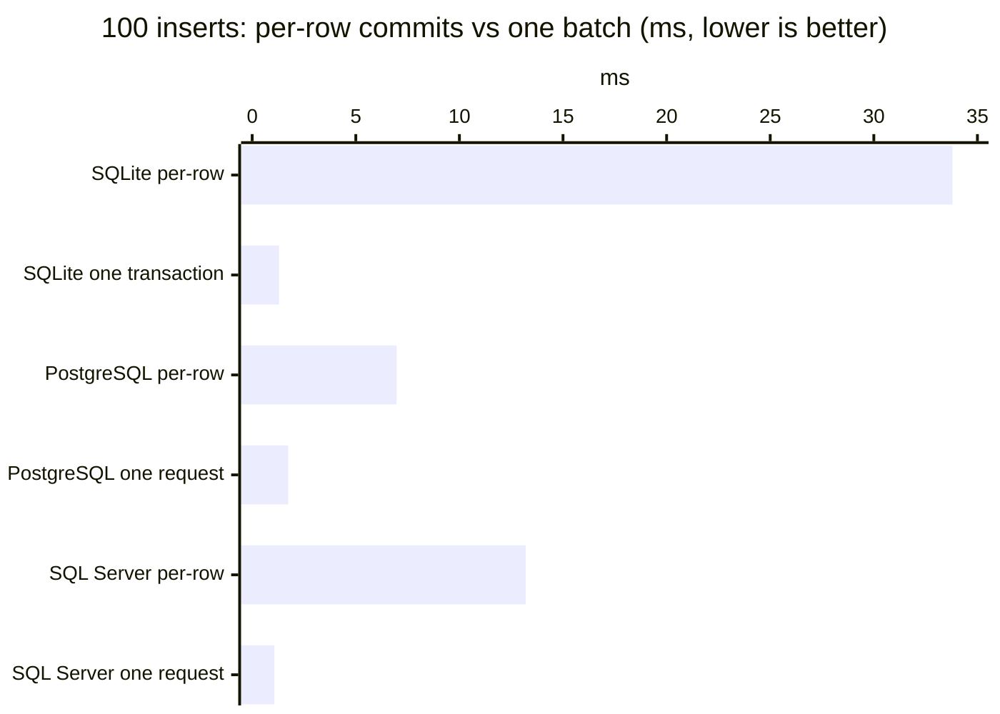
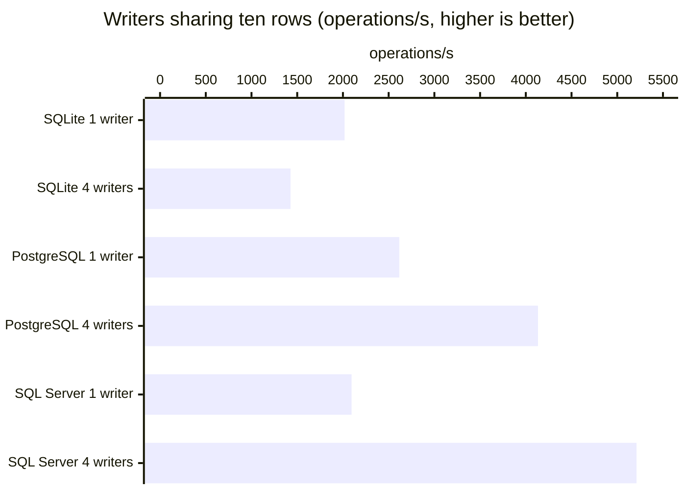

<!-- Experimental only; not reference material for creating production PSU resources. -->
# Database providers: SQLite, PostgreSQL and SQL Server

Why this exists: to find which application-database choices actually change a
small PSU app's behavior. The answer is mostly **how you connect and write, not
which engine you pick**. Through PSU, every read already costs 16–19 ms of HTTP
and JSON handling, which hides sub-millisecond engine differences.

- **SQLite** wins on simplicity and connection cost: no service to run, and a
  new connection is under 1 ms. It is the right default for one host with
  short, batched writes. It loses under concurrent writers: four writers got
  less total work done than one.
- **PostgreSQL** read multi-row results fastest and scaled readers well. Its
  writers needed rows locked in key order to avoid deadlocks, which cost
  throughput.
- **SQL Server** scaled concurrent writers best and had the fastest
  single-request batch insert. It fits where Windows authentication and SQL
  Server skills already exist. A SQL-login connection costs about 65 ms
  because of SQL Server 2025's password hashing, so **pool connections**.
- **All three**: batch commits and server round trips, pool connections, and
  return only the fields the caller needs (projection cut a 500-row PSU
  response from 1.08 MB to 23 KB).

| 10,000 records, 256-character payloads | SQLite | PostgreSQL | SQL Server |
| --- | ---: | ---: | ---: |
| Keyed row, direct / PSU (ms) | 0.34 / 18.8 | 0.44 / 16.3 | 0.37 / 17.5 |
| 500 rows, direct / PSU (ms) | 13.5 / 42.3 | **9.4 / 36.4** | 12.4 / 39.6 |
| New unpooled connection + keyed read (ms) | **0.77** | 17.7 | 64.8 (SQL login), 2.69 (Windows) |
| 100 inserts, best method (ms) | 1.30 | 1.74 | **1.07** |
| Four readers (operations/s) | **4,495–4,681** | **3,856–4,599** | 3,634–3,708 |
| Four writers ÷ one writer | 0.7× | 1.6× | **2.5×** |
| Extra service to install and operate | **None** | Yes | Yes |

## Method

- One workstation (Ryzen 5 9600X, 32 GiB, NVMe) running PSU 2026.3.0; SQLite
  3.53 (WAL, `synchronous=FULL`), native PostgreSQL 18.6 and SQL Server 2025
  Standard Developer, all on loopback with default durability settings.
- Seeded synthetic records (seed 1108) in three shapes: 1,000/256,
  10,000/256 and 10,000/2,048 records/payload characters.
- Seven shuffled measured blocks after a warm-up. Each case checks its result
  against the expected fields.
- Direct timings run through PowerShell with a reused connection. PSU timings use
  authenticated Integrated endpoints and include HTTP and JSON parsing. Job
  timings include submission and polling.
- Concurrency uses separate warmed, gated processes. Each worker first runs ten
  checked operations of its own role, then runs 200 operations per burst; writers
  contend on ten shared rows.
- Indexed and unindexed reads are counterbalanced pairs. An index helped the
  2,048-character documents (6 of 7 pairs) but not the 256-character ones.
- Operating checks: isolation and locking, rollback, backup and actual restore;
  `DBCC CHECKDB` and `pg_amcheck` where they apply.
- Write throughput comes from the November 20 repeated passes, three per
  provider; the other figures come from the initial passes.

## Limits

Passes ran separately with different connection, pooling and memory settings, so
they are not a ranking of engine speed. Repeated passes disagreed by up to about
2× on small-shape sequential reads, cause unknown. Repeated ASCII payloads compress
unusually well in PostgreSQL. Remote hosts, sustained load, cold caches, crash
recovery, HA and production permissions were not tested.

## Evidence and history

Portable summaries live in `database/*Evidence.json`. The archived harness is
`database/DatabaseHarness.zip`: unmaintained, so extract it before reproducing.
Each script's help covers its use. Raw samples stayed in ignored `tools/output/database/`.

- 2026-11-08: initial passes for all three providers.
- 2026-11-08: review corrections. Workers now warm up their assigned role, and
  index reads are paired. SQL Server was rerun (`SqlServerReviewedEvidence.json`).
- 2026-11-20: three repeated passes per provider. PostgreSQL increments now lock
  rows in key order after 45 deadlocks; compare its writer results only with
  key-order passes.
